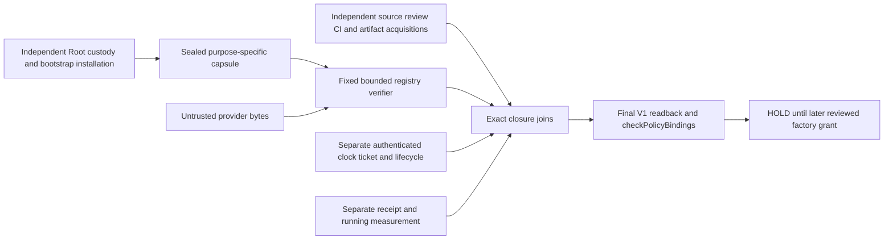

# P02 independent registry attestation — candidate 1

Status: UNREGISTERED_CONTRACT_CANDIDATE, actual independent review pending.
Root msg_f68dc38baa0f authorizes this design and synthetic model only. Nothing
here installs trust, approves a protocol, issues InstalledPolicy or enables K1.
The exact source base is c76d0d66895503adde39288544929ff35cd6c281.

## 1. Goal, evidence and existing boundary

The goal is to authenticate the installed-policy registry independently of the
plan, provider and record being checked. Acceptance needs an externally
provisioned purpose/scope/key/codec/verifier binding, authenticated provenance,
independent current status/time and installed/running identity joins, then
unchanged K1 checks. Missing any authority means HOLD with no opaque result.
The source-inspection manifest binds the actual source and prior decisions.

At this base RegistryPort.readRegistry returns untrusted records;
authenticateRegistry always refuses. LoadInstalledPolicy has no positive
constructor. checkPolicyBindings validates only necessary consistency, including
some review/CI presence checks, and never authenticates their origin. Since
de71 its policy code gained member scope/DER/SPKI uniqueness checks; ports.go
is unchanged and still refuses all registry authentication. k1_bridge.go
remains the sole new production K1 caller.
Neither a valid Go type nor those existing assertions provision an anchor.

The 4ce rev2 design and fe7 review retain independently installed trust,
publication/current nonrevocation, actual running-code measurement and clock
mechanism obligations. The actual 7d979761 and 0c5 reviews close their bounded
code deltas, not P02. No closed PL gate, accepted merge, pin or test count is
reopened. The accepted ea276 Core and c76 delivery are CODE facts only.

## 2. Authority originates outside the registry

Proposed authority objects are immutable, private composition values; there is
no public constructor, JSON decoder, callback or option that issues one. They
are not new production types in this task.

| Independent object | Required contents and origin | Actual state / owner |
| --- | --- | --- |
| ProvisioningCapsule | Root-selected deployment selector, exact ordered legacy-two cohort/scope digest, installation generation, capsule version, allowed format/schema/projection/algorithm/verifier closure hashes, registry issuer Ed25519 SPKI DER and fingerprint, original key interval, purpose and exact scope, authenticated lifecycle/freshness provider identities, minimum record/key epochs, required CI policy and source-choice identity | NULL/HOLD; Root provisions through separately reviewed operator custody mechanism |
| RegistryIssuerAuthorization | Explicit fresh installed-policy-registry READ-SNAPSHOT signing delegation for that exact selector/scope/key/format/version; separate from registry release/head mutation and leaf, planning, CI, review, TLS and archive roles | NULL/HOLD; Root authorizes, named read-snapshot issuer operates |
| SourceAcquisitionSnapshot | Original immutable source, review, CI and artifact bytes obtained by independently configured provider identities; actual review verdict/coverage and Root release/source-choice decision | No registered P02 producer; future provenance acquirer / Codex implementation, Root identity provisioning |
| AuthenticatedLifecycleSnapshot | Current registry/key/publication/reviewer/provider/installation status, exact current record digest/version, rollback floor and provider version, bounded checked/expiry times | NULL/HOLD; separately reviewed status authority |
| AuthenticatedReadTicket and ClockInterval | Private acquisition binding, purpose/scope/selector, currentVersion, lower/upper real-time bounds and a recheck token, independently authenticated; max uncertainty1second and age120seconds or stricter pinned bounds | NULL/HOLD; separate clock/freshness purposes, no record-supplied Now |
| RunningInstallationSnapshot | Independently authenticated receipt and actual integration process/executable/link/runtime closure under held OS identity with final readback | NULL/HOLD; separate installation/running-code purposes |

Root is the decision owner, not a claim inside a JSON object. The future
provisioning mechanism must authenticate the actual decision issuer and exact
target/scope before sealing the capsule. A CLI message, unsigned export, root
file ownership, good TLS connection, matching filename or local hash alone does
not do this. Public aggregate deployment/key/host bindings stay null. Actual
private binding is Root's later work, not a newly inferred configuration.

The registry provider cannot choose its anchor, expected scope/selector/version,
verification code, accepted verdict or required CI steps. Capsule lookup uses
the already configured selector table, never a record URL/path. An untrusted
selector is merely a lookup request: ASCII1..128 characters from the existing
letter/digit/hyphen/underscore alphabet, then exact capsule match. No fallback,
system-root discovery, provider-selected plugin or dynamic verifier loading.

The proposed private capsule descriptor is <=64KiB and has a closed parameter
set in provisioning-parameters.json. Its digest is computed from the exact
externally authenticated sealed descriptor bytes, not a self-hash field.
provisioningGeneration and capsuleSHA256 must be protected in both the signed
response and stable record identity. They prevent a reused key/selector and
reset numeric anchorVersion from reinterpreting an old installation as a new
one. The independently protected generation/floor still cannot be reset by a
registry reply. Unknown custody or loader provenance keeps H1/H6 open.

## 3. Bootstrap dependency and explicit stopping points

The bootstrap verifier/loader must itself be installed through an independent
operator-approved source/binary/receipt policy. It is not authenticated by the
registry it is about to verify. A minimal independently pinned parser and
Ed25519 implementation checks the capsule authorization before any registry
payload can influence execution. Its source, binary, dependencies and load path
are part of that externally approved installation closure. This dependency is
absent, not implemented by K1TrustedContext or NewService.

There is no circular rule saying "this registry authorizes the executable that
authenticates this registry". The authority graph starts at an independently
provisioned bootstrap/custody decision. Registry signatures can authenticate
claims about a target only after that start. The target's actual running identity
must independently match its receipt and measured executable; a registry's own
runningExecutableSHA256 claim is not a measurement. Self-hashing without an
independently registered mechanism, an inv-node VCS string, argv0, image/ZIP hash,
or another executable does not close RunningCodeMeasurementPort. P02 does not
choose a TPM/OS/remote-attestor mechanism or create one.

Named blockers, all real values NULL/HOLD:

* H1: authenticated Root custody/provisioning decision and bootstrap loader.
* H2: actual purpose-specific registry key/delegation, format and verifier
  registration; safe lifecycle/key-epoch advancement mechanism.
* H3: independently authorized source/review/CI/artifact acquirer and Root
  release/source-equivalence publication; unsigned API snapshots are facts only.
* H4: authenticated lifecycle/freshness/read-ticket and real clock mechanism.
* H5: independent installation receipt, running-process measurement and recheck.
* H6: authenticated durable antirollback floor ownership/update/recovery rules;
  P02 may consume a floor but cannot reset or advance it.
* H7: a reviewed, linked K2 integration entrypoint and its versioned package.

Registry signature validation can be tested without satisfying these. Production
InstalledPolicy issuance cannot. Archive/status/clock/running purposes remain
separate; this design does not silently implement their authorities.

## 4. One candidate format, not one of the registered 28

Candidate format: fleet5-p02-registry-candidate:1.
Candidate purpose: installed-policy-registry. Candidate algorithm: Ed25519.
Candidate signature domain ASCII: fleet5/p02/installed-policy-registry/candidate/v1.
These names are UNREGISTERED. Approval requires actual contract review and
Root's separate registration decision. No descriptor, wire pin or ABI changes.

Existing normalized-proof-v1 is intentionally not treated as P02 authorization.
The fixed CI subject lacks correlation, job/step policy and artifact ID/size;
the fixed code-review subject lacks verdict and exact approved review coverage.
Neither grants registry provisioning. Their actual purposes may authenticate
original provenance within their independently authorized scopes, but cannot
be relabelled registry approvals or extended in place. node-floor-v2, normal-v2,
SF1 and RS1 also retain their exact unrelated purposes and plain floors.

The closed envelope is {body,signer,signatureHex}. Body includes format, purpose,
selector, scopeSHA256, capsuleSHA256, provisioningGeneration, anchorVersion,
recordVersion, requestBindingSHA256,
issuedAt, validUntil, facts and ciRuns. Signer contains only keySPKISHA256;
the actual SPKI DER, algorithm and authorization come from the capsule. An
included public key, certificate chain, approved=true, trusted=true, verifier
selector, required-job policy or alternate format is an unknown field/refusal.

Signature message = fixed candidate domain bytes || one NUL || canonical UTF-8
JSON({body,signer}). Signature is exactly64Ed25519bytes represented by128lowercase
hex characters. SPKI fingerprint is SHA256 of exact canonical Ed25519 SPKI DER,
not SHA256 of raw32public bytes. The capsule supplies the original DER and
allowed signer. Verification must use strict Ed25519, exact key interval and
purpose/scope delegation; no X509/TLS/planning-key inference. Whole raw envelope
response identity is SHA256 of its exact canonical bytes, separately from the signed
projection digest. Signature domain/format/schema/verifier hashes are pinned
outside the payload. They cannot be bootstrapped from the envelope.

reviewScope is a Root-assigned ASCII scope identifier. It does not replace the
actual review's exact UTF-8 scope/target/verdict bytes: reviewCoverageSHA256 and
the authenticated Root coverage mapping must bind those original bytes. An
unchanged label with changed review contents still refuses. The candidate policy
schema freezes the current28 descriptor/schema/codec/verifier constants at c76;
a changed source contract set needs another reviewed schema/capsule version.

The externally authenticated head binds a STABLE RegistryRecordIdentity, not
the raw fresh response digest. Define it exactly as SHA256(canonical JSON of
body fields format,purpose,selector,scopeSHA256,capsuleSHA256,
provisioningGeneration,anchorVersion,recordVersion,facts,
ciRuns), removing only facts.runningMeasurementSHA256. It excludes response
requestBindingSHA256/issuedAt/validUntil and signer/signature. Stable facts include
the approved target executable/source/receipt/lock/link identities; the fresh
running proof digest is an independently authenticated response observation.
The complete signature still protects every response field including that digest.
sourcePublicationAnchorSHA256/sourceAcquisitionSHA256 refer to original source
evidence that PRECEDES the registry record, never a future registry publication
head. Current registry head/status is acquired separately and is not in body.

This avoids both future-head and read-ticket hash cycles: Root's separate
publication authority approves a stable record/payload identity first; the
read-snapshot issuer later signs its response to an authenticated ticket without
writing a new registry record or advancing a floor. It cannot select/approve a
different stable record. Two new tickets may have different signed/raw responses
but the same independently approved RegistryRecordIdentity. A missing first
publication remains HOLD; P02 grants no prepublication installation/effect path.
An installation receipt's candidate dependency is on the sealed policy PAYLOAD
and target closure, not a future response/head; the separate receipt purpose
must be reviewed for this acyclic join before H5 can close.

Parsing is deterministic: strict UTF-8, no BOM, duplicate keys, trailing data,
NaN/infinity, floats, negative zero, unknown fields or noncanonical encoding.
Manifest strings are bounded printable ASCII; no surrogate/escape aliasing.
Integers are exact JSON integers0..2^53-1, with type(bool) excluded. Object keys
sort lexicographically; arrays preserve specified order; encoding is compact,
no insignificant whitespace, UTF-8 and no escaping alternatives. This restricted
candidate projection is not an amendment to K1's C2 codec. The schema and pure
model pin the same field set and limits. Valid JSON alone is insufficient.

Envelope <=2MiB, depth<=32, nodes<=100000, total string bytes<=1MiB, each string
<=65536bytes. At most8CIruns,8jobs/run and128steps/job. No duplicate run IDs,
job names/IDs or step numbers/names within a job; fixed canonical order by run
workflow+runId, job name and step number. Bounds apply before expensive
signature/schema evaluation; reject overflow, decompression or recursive bombs.

The separate sealed policy payload is <=16MiB, with exact canonical bytes and
the closed policy-payload candidate schema. Graph/DER/scope byte objects use
canonical lowercase hex; decode only after checking encoded limits and demand
round-trip equality. At most512grants, two ordered old-member entries and the
exact28independently pinned contract IDs. No status or RegistrySHA256 field is
self-asserted in that payload. Candidate mapping for later review:
policyData.RegistrySHA256 := SHA256(exact sealed policy payload bytes).
This avoids a self-hash fixed point. It is distinct from source registration
manifest, proof-slot registry, graph and envelope digests. Existing K1 checks
only RegistrySHA256 syntax; it does not authenticate this proposed mapping.
The future factory derives provenance and grant ACTIVE state from independent
authenticated snapshots, not policy-supplied status. All this mapping is a
candidate contract, not current shipped serialization.

## 5. Complete closure joins and independent producers

authority-matrix.json assigns each manifest fact to its required independent
origin, authenticator, private expected value and owner. It is normative with
this document and the two closed schemas. A missing or ambiguous origin fails.

* Policy: exact selector, version, payload bytes and cohort scope; independent
  registry digest, graph bytes/NodeKinds, semantic pins and all28contract/schema/
  codec/verifier pins. The plan cannot supply its own installation. Public
  member certificate/CA/URI/DER/SPKI/grant intervals retain unchanged K1 joins;
  old PC2/PC4 identities are not a new five-member issuer cohort.
* Source and review: actual immutable repository/source/tree closure; each
  actual review issuer, verdict, exact target and scope, and exact original raw
  review bytes. Root's independently authenticated source-choice decision must
  cover all relevant code parts. A narrow test delta verdict cannot approve an
  entire new binary. Inherited review coverage requires explicit source/blob
  equality and Root's scoped successor decision, not SHA text alone.
* CI: independently configured repository/provider and workflow identity,
  exact head/ref/event/path/correlation/attempt, required run/job set and every
  required step's actual conclusion. Capsule/Root policy chooses required steps.
  An overall green flag, a name matching Core, an omitted job, an inherited run
  from another head, or a required SKIPPED step never substitutes. Optional
  steps may be skipped only in an independently fixed explicit policy; they
  receive no execution credit. A false optional native/S08 flag remains NOT_RUN.
  The actual step set must equal the disjoint independently required and
  explicitly optional sets; unknown extra steps are not silently authorized.
* Artifact: actual immutable artifact ID, run/head, GitHub digest/size and exact
  downloaded bytes; closed platform/member path and binary digest. ZIP/image/
  archive identities are different typed fields from the running binary.
  Downloads must come through the pinned provider, without record-selected URL
  redirects. Stream hash under a256MiBcap outside DB locks. Future bounded
  archive inspection rejects duplicate/absolute/traversing/symlink members and
  caps expanded closure at1GiB; no extraction or execution by P02.
* Binary: actual VCS revision/modified flag, exact toolchain and dependencies,
  both Go modules/platform inputs, helper modules plus launcher+runtime lock,
  and linked integration closure. VCS text alone does not prove linked K1/K2.
* Installation/running: independent receipt source/binary/lock/link identity,
  held executable/process/generation/UID/namespace/root identity and current
  remeasurement. Exact executable SHA must equal Verifier.ArtifactSHA256;
  source/receipt/runtime-lock/linked closure must equal the independently
  authenticated installation. The registry merely commits these expected
  values; separate RunningCodeMeasurementPort authenticates the observation.
* Status/time: current independent publication/grant/key/certificate/receipt
  status and nonrevocation at realNow; original signing intervals and original
  event/publication time anchors remain distinct. A registry timestamp cannot
  prove it was not backdated by its signer. Offline backdating residual remains.

For inherited K1 coverage, review191b accepts56651 Go; eb32 changes README/test/
CI around byte-equivalent Go and Root independently selected that successor.
Subsequent accepted source choices and PL reviews are equally scoped. This is
the pattern of evidence to authenticate, not permission to trust an arbitrary
review JSON. The available ea276 inv-node artifact has valid source CI/VCS
provenance, but no approved installed K2 application/entrypoint/running closure.
Frozen e50 packaging predates K1 and cannot install c76/ea276. Future packaging,
runtime-lock/source/manifest/rollback/trust provisioning remains separate work.
No new archive is built or replaced here.

## 6. Freshness, monotonicity and idempotent reads

An authenticated read ticket binds one private acquisition to purpose/selector/
scope, currentVersion, status provider version and requestBindingSHA256. It is
not caller supplied and P02 does not allocate a nonce, sign or persist anything.
Ticket issuance/authentication is an explicit H4 dependency. A new acquisition
requires its own binding; an older response copied into it refuses. An exact
same-acquisition reread may return the same bytes idempotently while the same
ticket and status remain valid. It cannot mint another operation or authority.

Require signed recordVersion == authenticated current record version >= the
independent rollback floor, exact current stable RegistryRecordIdentity, current ACTIVE and
unrevoked issuer/record/source/receipt statuses. Versions are ordered integers
inside a separately authenticated provisioning generation; changed generation,
key epoch or lower capsule/floor cannot be accepted from the registry itself.
Retirement does not delete history or reset a floor. No automatic key rotation,
downgrade, alternate authority, retry or offline recovery is implied.

Check all time predicates over the entire authenticated [L,U] interval, not a
favorable endpoint. Require U-L<=1second; keyNotBefore<=issuedAt<keyNotAfter and
keyNotBefore<=L<=U<keyNotAfter for this current registry signing authorization;
checkedAt<=L<=U<statusExpires; U-checkedAt<=120seconds;
ticketIssuedAt<=issuedAt<=L<=U<validUntil; U-issuedAt<=120seconds;
U<ticketExpiresAt and exact
acquisition binding. Use tighter capsule/provider expiries where present.
Unknown/revoked/stale/expired/future/backdated time anchors refuse. Do not move
Now, expand age or infer real-clock authentication from a test clock.
This current registry-key condition does not change historical K1 consuming-time
key intervals or turn an expired historical lease into current authority.

Capture immutable V0=(capsule installation generation/version/digest, registry
currentVersion/digest, lifecycle version, ticket, running receipt/process token).
Close any short containing read transaction. Perform bounded provider/artifact
I/O and pure verification with no held DB row locks. Before issuing any opaque
input, independently reread V1 and require exact V1==V0 and fresh time/status/
running bounds. Changed, unavailable or ambiguous readback refuses, no silent
retry. P02 is not a fence for uncoordinated mutators; a future transaction/fence
owner must mediate relevant mutation. Clock/status/running implementations are
not granted by this candidate.

## 7. Mandatory gate order and refusal

1. Private independently authenticated capsule/bootstrap/issuer authorization,
   immutable version/floor and scoped lookup; no payload yet trusted.
2. Independent clock/ticket/lifecycle/running acquisition available, V0 captured;
   absence HOLD, not a registry-authenticated substitute.
3. Bounded owned byte snapshot; strict canonical envelope and payload schema.
4. Fixed projection/signature/purpose/key/interval/scope/version verification.
5. Independently acquired source/review/CI/artifact and installation/running
   closure joins; exact payload/hash/graph/contracts/grants/member bindings.
6. Independent current status/replay/floor/time evaluation and exact V1 recheck.
7. Deep freeze exclusive-owned values and call checkPolicyBindings with the
   independently authenticated runningData BEFORE any future K1 constructor.
8. Only a later explicitly reviewed positive factory grant may issue a private
   service-bound InstalledPolicy. K1 still performs its unchanged cryptographic,
   contract/recipe/semantic and original consuming-time checks thereafter.

All untrusted public registry-input failures expose the existing opaque
TRUST_UNKNOWN_OR_PIN_MISMATCH, with no raw provider/K1/parser diagnostics. Internal
candidate reasons are the closed refusal-matrix IDs, not new public ABI codes.
Separate missing-purpose gates keep their current closed errors when their
actual future APIs run. The model returns no policy/report/current token.

Ownership is explicit: caller exclusively owns candidate bytes during the one
bounded copy; frozen bytes/tuples are then private. No arbitrary objects,
marshalers, callbacks, custom mappings, borrowed mutable slices or concurrent
mutation guarantee. No file/process/network/DB/clock I/O inside the evaluator.
The synthetic harness reads fixtures and writes evidence, not the pure model.

## 8. Synthetic acceptance and smallest next seam

The pure evaluator is a SYMBOLIC_CONTRACT_MODEL. Its external already-bound
signature table stands for independent signature authentication; it performs
NO Ed25519/X509/OS/provider authentication and contains no private key. Green
controls are labelled SYNTHETIC_ALREADY_BOUND, never producer/runtime acceptance.
Even model green must map to production TRUST_UNKNOWN_OR_PIN_MISMATCH here.
Negative mutants exercise parsing, anchor/key/purpose/scope/selector/version,
actual review/CI joins, required-step omission/skip, artifact bytes/identity,
receipt/lock/link/running mismatch and rollback/replay/stale/revoked/unknown.
They are new bounded model cases, not reruns or completion of A01-A40.

After actual independent contract review, the smallest candidate implementation
seam is a pure internal codec/projection/strict-signature verifier accepting
private already-authenticated anchor/snapshot types; only negative/default-refusal
composition until H1-H7 are independently closed. Root must grant exact files,
source, tests and review boundary before product code. No port implementation,
InstalledPolicy issuer, entrypoint, key/anchor provisioning or installation is
included. Subsequent source acquisition adapters and running/time/status purposes
need separate grants and tests; effectful K2B remains farther downstream.

Root's concrete review decisions are: candidate byte/identity mapping and bounds;
independent provisioning/custody mechanism and purpose delegation; authentic
provider/reviewer/source-choice publications; status/ticket/floor protocol;
installation/running measurement mechanism; then exact smallest code grant.
All actual bindings stay NULL/HOLD until those real decisions and evidence exist.

| Dependency piece | One decision/work owner | Acceptance evidence / next edge |
| --- | --- | --- |
| D01 candidate contract and model | Codex | Exact source/schema/model hashes, negative/control results, Docs; then actual review |
| D02 independent contract review | Claude, assigned by Root | Actual verdict with exact D01 target/scope; reviewer grants no code |
| D03 custody/bootstrap/purpose registration decision | Root | Authenticated installation/provisioning mechanism and immutable public binding; H1/H2 remain HOLD |
| D04 smallest pure codec seam | Codex only after Root grant | Strict signature/parser/projection tests on private types, no provider/factory; requires D02 |
| D05 independently authenticated source acquisitions | Codex only after a separate grant | Actual issuer/provider/review/CI/artifact authentication and scoped Root release selection; requires D03 |
| D06 clock/status/ticket/floor/running implementation | UNASSIGNED_HOLD; Root must assign each purpose separately | Actual mechanisms and current bounded readbacks; no P02 paper substitution |
| D07 positive policy factory | Codex only after a later grant | D03-D06 real bindings, immutable V0/V1 and checkPolicyBindings before K1, actual review |

D04 is the smallest proposed next code seam, not permission to start it. D05-D07
cannot be bypassed by a successful D04 signature fixture. No K2B/effect work is
on this dependency path until its separately reviewed authorities are granted.
