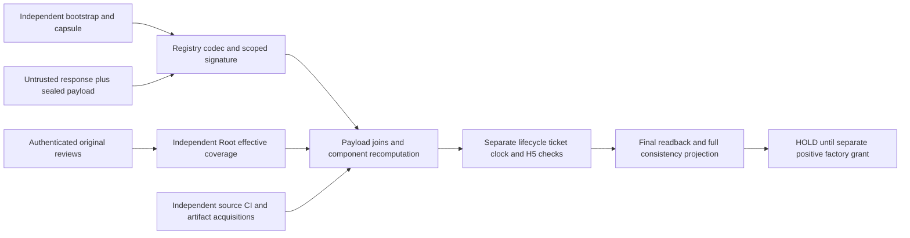

# P02 Rev2 payload, coverage and projection contract candidate

Status: UNREGISTERED_REV2_CANDIDATE_REVIEW_REQUIRED. Root msg_d888d8ceb1e3
grants this fix-only document/model delta, not D04 or a positive factory.
Base78468d0aec295c712dd1ea33bea1401d1d4939a4 and every prior file stay frozen.
The actual de4 review and its38probe rows are archived byte-exact, not rerun.
Its envelope findings are retained. This candidate changes the format version
because payload components, ordered reviews and projection semantics changed.
Nothing here is an accepted wire/domain/key/ABI/producer or installed authority.

The sole normative payload table is payload-contract.json. It covers every
payload field, the exact bytes of each derived digest and41leaf fields of the
current policyData/publication/contractPin/grant/member/provenance projection.
The three closed schemas define structure/lexical bounds; candidate_model.py
executes codec, joins and ordering. gate-order.json is generated from that
model's single STAGES list. Schema validity alone is neither canonical decoding
nor authentication. Any conflicting interpretation is HOLD, not permission to
choose a convenient projection.

## 1. Retained trust and scope boundary

Actual production ports remain unchanged: registry/archive/status/clock/running
authentication refuse and no constructor issues InstalledPolicy. P02 can only
consume independently provisioned purpose-specific trust. A provider, caller,
plan, payload, registry signer, filename, hash, label or self-issued key cannot
choose the trusted key, selector/scope, verifier, approved review scope, CI policy,
primary tuple or a green verdict. Bootstrap authority starts outside the record.

H1 custody/bootstrap/capsule, H2 registry purpose/codec/key authorization, H3
source/review/CI/artifact/effective approval, H4 status/ticket/clock, H5 receipt/
running measurement, H6 protected floors and H7 linked entrypoint remain actual
NULL/HOLD. The private model sources are explicitly SYNTHETIC_ALREADY_BOUND
hypotheses. There is no production loader for them and no signature, X509, OS,
provider or real-clock authentication in the model. Its production projection
always returns TRUST_UNKNOWN_OR_PIN_MISMATCH, including every green control.

Only this unique History/Evidence changes. K1/28raw contracts/schemas, source
pins, Go modules,13types/73baseline census, current seven-file closure and all
accepted K1/PL/merge/Core observations remain unchanged. Raw7 stays UNREGISTERED;
A01-A40 remain NOT_RUN, not model cases. No current view, prepublication or
crossmigration fence authority, normal:3 operation, effect, installer, port,
entrypoint, live key/CA/host/service/DB/Engine/SSH action or B protocol is granted.

## 2. Exact codecs and explicit payload components

Candidate format fleet5-p02-registry-candidate:2, purpose
installed-policy-registry, signature domain
fleet5/p02/installed-policy-registry/candidate/v2 are UNREGISTERED. The candidate
signature message stays fixed domain || NUL || minimal canonical UTF-8
JSON({body,signer}); signer names only the externally pinned DER-SPKI hash.
No algorithm/verifier/key-selection field is accepted from the record.

Minimal canonical JSON for the envelope and policy payload means strict UTF-8,
no BOM, duplicate key, trailing data/LF, float/NaN/exponent/-0, escape alias,
unknown property or serialization callback. Integers are exact safe integers;
the closed schemas impose their tighter signed/unsigned field bounds. Keys sort
in UTF-8 order, no insignificant whitespace, no trailing newline. Manifest and
outer policy strings use the same printable-ASCII subset as the prior candidate.
Out-of-subset actual bindings require HOLD, not Unicode normalization. The
envelope limit remains2MiB, depth32/nodes100000, bounded strings; payload is at
most16MiB with its explicit graph/DER/component limits. All input byte slices
are exclusively owned while copied and immutable afterward. No concurrent
mutation safety is claimed.

K1-C2 is distinct from this outer codec: exact Go Marshal rules include HTML
escaping for ampersand/angle brackets, raw Unicode and U+2028/U+2029 escaping.
Every authorityScopeC2Hex decodes lower/even hex, round-trips hex exactly, parses
strict bounded C2 and MUST re-encode to the same C2 bytes. Its decoded value is
one closed NODE/COHORT/COMPONENT shape. Unknown classes, noncanonical JSON,
raw ampersand in place of C2 escaping, invalid UTF-8/surrogates or aliases refuse.
No role string or structurally valid scope confers authorization.

All schema lexical patterns use explicit end-of-input `(?![\s\S])`, not dollar
anchor search semantics. The actual Python-jsonschema harness tests final LF
AND CRLF for selector, digest, public-key and component-hex fields. The codec
independently enforces canonical bytes and full lexical validity.

The payload is a closed object containing selector, version, verifier,
contractPins, grants, cohortId, members, graphHex, nodeKinds and the NEW explicit
semanticPins, proofSlotRegistryHex and designRegistrationHex components.
RegistrySHA256, Provenance, grant status, approved scope and current status
are forbidden self-fields. Members stay ordered PC2/PC4 with complete original
scopes, DER/CA, distinct scope/DER/SPKI and node-leaf bindings. They are the old
logical two-member cohort, not a new five-node issuer.

Graph/proof-slot/registration hex carries EXACT original raw source bytes.
Their inner JSON/newlines are not reserialized to make a digest match. The
payload itself must be canonical. semanticPins is a closed6field map naming
the installed K1 source-pin set, recipe definitions, derived-digest contract,
proof-slot registry, graph and NodeKinds digests. Each must equal a separately
authenticated installed-source constant. A missing source is an explicit H3
failure, not zero, a guessed filename or a new default. The immutable28contract
ID/hash/schema/codec/verifier constants are copied without a repin.

The payload table defines ALL eight payload-derived facts:

| Fact | Exact digest input |
| --- | --- |
| policyPayloadSHA256 | Exact canonical payload byte slice |
| graphSHA256 | Decoded graphHex raw bytes |
| contractSetSHA256 | K1-C2 of the complete28entry contractPins object |
| semanticPinsSHA256 | K1-C2 of the closed semanticPins object |
| cohortScopeSHA256 | K1-C2 of class COHORT/cohortId/ordered complete member scopes |
| keyGrantsSHA256 | K1-C2 of ordered role/decoded scope/public key/original integer intervals, excluding current status |
| registryProofSlotsSHA256 | Decoded original proofSlotRegistryHex raw bytes |
| designRegistrationSHA256 | Decoded original designRegistrationHex raw bytes |

Every listed fact must equal the recomputation even if the outer response,
signature tuple and independent coarse payload digest are already bound.
cohortScopeSHA256 also equals body.scopeSHA256 and the independent capsule.
NodeKinds is covered by its own semantic source pin. No safety fact was deleted
to make a control pass; obligation-map.json preserves every old requirement.

The public source-origin inspection found the historical registration encoding
distinction: immutable7ec1 Git LF blob SHA876554dc... versus frozen registered
CRLF byte SHAa0a05427.... Exact LF-to-CRLF serialization reproduces a0; it is a
CANDIDATE byte-origin recipe, not an original capture or authentication.
RD-P02-R2-REGISTRATION-BYTES requires Root's independent binding of that exact
recipe/immutable blob to the prior registration, or the original exact raw
artifact. H3 remains HOLD until then. The old a0 pin/observation is unchanged;
there is no generic newline fallback or source-original edit. Graph origin is
the actual immutable8874 registered artifact-reference graph, not an assumed
file in78468 ancestry. source-component-origins.json records exact origins.

## 3. Payload-envelope joins and version semantics

Require payload.selector==body.selector==independent capsule.selector. Version
is the canonical positive decimal string of body.recordVersion, no leading
zero/sign/space, and projects unchanged as policyData.Version. The independent
current lifecycle still binds that numeric version/floor/generation; a matching
payload cannot set its own expected version.

Payload verifier.sourceSHA equals the independently selected sourceSHA;
artifactSHA256 equals executable binarySHA256, NOT artifactZipSHA256;
reviewSHA equals the independently authorized EFFECTIVE approval publication;
ordered integer ciRunIDs equals ciRuns[*].runId in the canonical run order.
All current runs still bind the same selected source, exact ref/event/workflow/
correlation/attempt/jobs and disjoint independently required/optional step sets.
Required steps must actually succeed; skipped optional steps give no execution
credit. The registry cannot declare its own policy or pick a primary green item.

RegistrySHA256 projects as SHA256 of the exact sealed payload bytes, not a
field inside that payload, the source registration, graph, archive or response
digest. The source/provenance snapshot is acquired independently and authenticated
for its actual purpose before these joins. The model only assumes that source
authentication; matching its strings is consistency, not origin verification.

## 4. Original reviews and an honest effective source approval

Body reviews[] is ordered and closed: ordinal1..N, unique reviewSHA, exact raw
review SHA/target/verdict/scopeId/raw UTF-8 scope bytes+hash/reviewer identity/
SPKI/raw-review-byte digest. Original targets and verdicts NEVER change to match
a newer source. The authenticated review acquirer derives these from actual
original raw publications under separately registered reviewer identities.
The read-snapshot issuer cannot author that authentication or choose outcomes.

The independent Root coverage statement names current source/tree, exact original
review-set digest, an ordered COMPLETE source-partition mapping and a distinct
effective approval. Each part binds its original review SHA/target, independently
acquired reviewed/current byte-closure hashes and DIRECT or BYTE_IDENTICAL.
The complete required partition, current/reviewed hashes and exact accepted
original outcomes originate in the independently provisioned capsule/source
policy, not this response. Missing parts or mismatched bytes refuse. A label
saying equivalent is insufficient. A direct part requires the actual review
target to equal current source; an inherited part keeps the original target
and proves exact byte equality. General semantic equivalence is unsupported.
capsule.reviewedParts is an independently authorized scope-to-part allowlist,
not merely a list of blobs found in a reviewed commit. Root's coverage decision
must read each original verdict/scope/findings and bind exactly which source
partition it covers. The statement's review-set digest binds those original
metadata bytes to the part mapping; no caller or registry may add a covered part.

The effective approval is a DIFFERENT independently authorized publication:
publicationSHA, current targetSourceSHA, approved scope and actual verdict.
Its proposed purpose is root-effective-source-approval-candidate:1. H3-EA has
no registered issuer/anchor/format/verifier/port now, so actual use remains HOLD.
It must be authenticated by a future closed independent source, never arbitrary
review JSON, Root CLI text, a body label or the registry's own signature. Root
must decide the compatibility/authorization mapping before any positive factory.
The model uses an explicit already-bound H3-EA hypothesis, not an invented real
reviewer/key or a claim that the actual current source has a whole-target review.

effectiveReviewSHA/effectiveReviewTargetSHA/effectiveReviewScope/effectiveReviewVerdict
name that effective publication. The old raw single-review obligations moved
into reviews[], not into relabelled history. reviewCoverageSHA256 hashes K1-C2
of the exact coverage statement; sourceEquivalenceSHA256 hashes its ordered
parts; rootChoiceSHA256 is the independently authenticated approval evidence
raw hash, outside its own statement. The statement contains no future capsule,
payload, registry-response/head or own-evidence hash dependency. Original source
acquisition/time anchors also precede registry publication.

The actual c76/ea276 lineage has multiple scoped/inherited reviews and Root
source decisions. That history is the reason for this set representation; it
is not replaced with a fictional whole-source reviewer verdict. K1's unchanged
ReviewTargetSHA==SourceSHA check is preserved by projecting the effective
approval's current target, distinctly from every raw original target. Real
ReviewSHA cannot be populated this way until H3-EA is independently authorized.

## 5. Complete projection and independent status

payload-contract.json maps all41leaf fields, including all15provenance fields,
with origin/conversion and refusal. The model projection is a semantic DTO
only: Go []byte is shown as lowercase hex and time.Time as exact UTC Z strings.
It creates no opaque Go value and cannot be consumed as a K1 trust input.

Integer CI IDs become canonical decimal strings. capsule.primaryCI supplies
the exact runId/jobId/jobName; select exactly one authenticated run and job,
never the first/last green response. Its head/ref/workflow/run/attempt/job values
populate the single provenance fields; the selected run must be in CIRunIDs.
ArtifactDigest is archive artifactZipSHA256 while Verifier.ArtifactSHA256 is
the actual executable identity. The source artifact acquirer must authenticate
original artifact ID/run/head/size/digest/bytes and binary VCS/toolchain/module/
helper/runtime-lock/linked closure; it is not implemented by this model.

ReviewTargetSHA and ReviewScope come from independent effective coverage.
ApprovedReviewScope comes ONLY from the independent capsule. Copying a response
scope into both sides would erase the check and is forbidden. RunningExecutableSHA256,
receipt/runtime-lock/linked closure come from private independently authenticated
H5 and must equal the approved source/installation identities. All those real
inputs remain absent. A source pin, ZIP/image digest or registry echo is not an
actual held-executable/PID/start-generation/root/UID measurement.

Grant role/scope/public key/original interval originate in independently authorized
sealed data. Decode each authorityScopeC2Hex to the exact primitive AST. Epochs
are integer Unix seconds0..253402300799, no bool/fraction, converted exactly by
time.Unix(s,0).UTC(), with NotBefore<NotAfter. Current ACTIVE comes only from
independent H4 at GrantRegistrationID defined in the payload table. It is not a
payload status field. Original historical signing intervals may have ended while
current registration still permits original history; do not change Now or recast
them as current signing authority. Current registry-key validity remains a
separate strict step4condition.

Ordered member scope/DER/CA/SPKI uniqueness and node-leaf grant joins stay
mandatory. The symbolic model uses separately bound public-identity hypotheses;
it does not parse/verify X509 certificates. The real future checked factory must
call unchanged checkPolicyBindings/checkMemberBindings BEFORE any K1 constructor,
and K1 still checks actual chain/DER/URI/SPKI/key use/signature/role/scope, original
consuming times and independent current nonrevocation. No condition was removed.

## 6. H5 echo, freshness and the acyclic read flow

The private client request projection is EXACTLY the model request_projection:
format/purpose, independently installed capsule digest/generation/selector/scope,
independent current registry version/stable identity, provisioned integration
component identity, authenticated ticket ID/issue/expiry, and SHA256 of the EXACT
private authenticated H5 proof bytes. requestBindingSHA256=SHA256(K1-C2(request)).
No expected request value is learned from the response.

facts.runningMeasurementSHA256 is ONLY an echo of that request's H5 digest,
with ZERO authentication weight. The registry signer merely echoes a request
fact; its signature does not attest the running process. Only independent H5
supplies executable/source/receipt/lock/link/PID/start-generation/root/UID and
observation bounds. Missing, foreign, wrong-purpose, wrong-closure or stale H5
refuses even with a correct signed echo and matching request. A forged echo or
registry-chosen request binding also refuses. No Node M2/sideloaded observer or
another executable can substitute for this integration measurement.

Stable RegistryRecordIdentity binds all stable body fields, facts and ordered
reviews/CI. Exactly issuedAt/requestBindingSHA256/validUntil and the H5 echo are
excluded; signer/signature are outside that stable projection. The complete
response signature still protects them. An independent current head binds the
stable identity, not a future raw response hash. New ticket/new expiry/new H5
can produce a new signed read response for the same stable record without
updating the registry/floor. A fork, generation/capsule substitution, rollback,
old response into another request or unavailable independent head refuses.

All real-time predicates use the complete independently authenticated [L,U],
uncertainty<=1second, status/response/H5 age<=120seconds or tighter expiry,
strict upper expiry and original key interval. No record-supplied clock, widening,
favorable endpoint, old receipt/lock reset or automatic retry. Original historical
events retain their own consuming-time checks and offline backdating residual.
Independent current/source publication, grant, certificate, approval and receipt
status is required at realNow, never self-current registry assertion.

Immutable V0 captures capsule/current/version/status/ticket/running identity;
close short source transactions before bounded external I/O. Freeze owned bytes,
evaluate, then independently recheck V1 and require exact pinned token equality.
The model checks already-bound tokens only; it performs no actual readback or
clock measurement. No I/O behind held DB row locks and no uncoordinated-mutator
concurrency safety claim. Every actual acquisition/mediation purpose stays HOLD.

## 7. Single normative first-failed order

The evaluator/table share one STAGES definition. It refines the retained section7
order:1independent anchor/ownership;2independent source availability/types;
3envelope/payload/C2 codec;4scope/signature then registry-key interval;
5payload joins, components, original/effective reviews, source, CI, archive and
running-identity joins;6independent status, current version/floor, request/echo,
freshness and final readback;7complete consistency projection BEFORE future K1.
All earlier stages must succeed before a targeted refusal can count.

Thus toolchain+step6stale status refuses PROVENANCE at step5; a key interval
violation+toolchain refuses TIME at step4. The original de4 R35 output is
unchanged: its issuedAt800 also violates keyNotBefore900, so Rev2 O02 explicitly
exercises the step4priority while O01 isolates the intended step5vs6fault.
No earlier FORMAT/signature failure is claimed as closure of a payload join.

The14private reason IDs and constant opaque public refusal remain closed. No raw
provider/parser/K1 diagnostics escape as authority. Test traces include every
earlier passed stage and the first failure; table order is generated, not a
second hand-maintained list.

## 8. Evidence and next owner

The final targeted run reports executed rows AND distinct complete input tuples,
whose digest includes exact response/payload/artifact bytes and every bound
source/type/signature/readback input, excluding test ID and expected outcome.
Duplicate tuples fail the harness. C02 is a genuinely fresh ticket/expiry/H5
same-record control; missing independent current evidence is distinct from a
missing capsule. The original100rows/98distinct and reviewer38rows remain intact;
neither superseded reports nor smoke checks are added to the final case count.
All tests are STATIC/SYMBOLIC, no crypto/producer/runtime acceptance.

Codex owns this bounded correction and exact Docs delivery. Root first verifies
the frozen source/report and actual CI, then assigns ONE narrow actual Claude
delta review after the existing ready queue/reviewer release. No reviewer or
agent is launched by this worker. Only after that verdict may Root grant the
smallest D04 pure internal codec/projection/strict-signature seam on private
already-authenticated types with default-refusal composition. H3-EA and the
registration byte-origin decision remain explicit real prerequisites, alongside
H1-H7. No factory/provider/port/installer/current/effect grant or self-registration
is included; whole K2/fleet acceptance remains incomplete.
